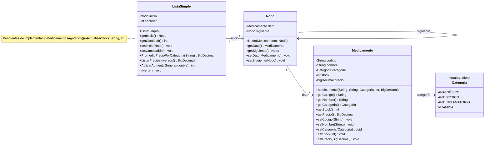

<div align="center">

# FarmaVida

### Sistema de Gestión de Inventario Farmacéutico · Parcial 1

Aplicación de consola desarrollada en **Java** (solo JDK estándar) que administra el inventario de medicamentos de una farmacia utilizando una **lista simplemente enlazada** como estructura de datos central. Cada operación del inventario está respaldada por su **documento de lógica** (pseudocódigo, trazados y casos borde) y por una **batería de casos de prueba**.

[](https://www.java.com/es/)
[](https://code.visualstudio.com/)
[](FarmaVida/src/ListaSimple.java)
[](#estado-del-proyecto)
[](https://github.com/RelaxUniver/Parcial-1/commits/master/)

</div>

---

## Índice

- [FarmaVida](#farmavida)
    - [Sistema de Gestión de Inventario Farmacéutico · Parcial 1](#sistema-de-gestión-de-inventario-farmacéutico--parcial-1)
  - [Índice](#índice)
  - [Descripción del Proyecto](#descripción-del-proyecto)
  - [Características Principales](#características-principales)
  - [Tecnologías](#tecnologías)
  - [Estructura del Repositorio](#estructura-del-repositorio)
    - [Detalle de archivos](#detalle-de-archivos)
  - [Arquitectura y Modelo de Datos](#arquitectura-y-modelo-de-datos)
    - [Diagrama de clases](#diagrama-de-clases)
    - [La lista en memoria (datos de ejemplo de `Main.java`)](#la-lista-en-memoria-datos-de-ejemplo-de-mainjava)
  - [Operaciones sobre la Lista](#operaciones-sobre-la-lista)
  - [Documentación de Lógica](#documentación-de-lógica)
  - [Material de Apoyo](#material-de-apoyo)
  - [Datos de Prueba](#datos-de-prueba)
  - [Batería de Casos de Prueba](#batería-de-casos-de-prueba)
    - [Salida esperada al ejecutar la versión actual](#salida-esperada-al-ejecutar-la-versión-actual)
  - [Cómo Ejecutar el Proyecto](#cómo-ejecutar-el-proyecto)
    - [Requisitos previos](#requisitos-previos)
    - [Opción A — Visual Studio Code (recomendada)](#opción-a--visual-studio-code-recomendada)
    - [Opción B — Terminal (solo JDK)](#opción-b--terminal-solo-jdk)
  - [Convenciones de Diseño](#convenciones-de-diseño)
  - [Estado del Proyecto](#estado-del-proyecto)
    - [Progreso](#progreso)
    - [Flujo de trabajo para completar una operación pendiente](#flujo-de-trabajo-para-completar-una-operación-pendiente)
    - [Observaciones conocidas](#observaciones-conocidas)
  - [Equipo de Trabajo](#equipo-de-trabajo)
  - [Contacto](#contacto)

---

## Descripción del Proyecto

**FarmaVida** es un proyecto académico de evaluación parcial (**Parcial 1**, Estructuras de Datos, curso 2026-2027) desarrollado por el Equipo 1. Simula la gestión del inventario de una farmacia, donde los medicamentos se almacenan en una **lista simplemente enlazada** ([`ListaSimple`](FarmaVida/src/ListaSimple.java)) construida manualmente sobre nodos ([`Nodo`](FarmaVida/src/Nodo.java)) que se recorren desde `inicio` hasta `null`.

Sobre esta estructura se definen **cinco operaciones de inventario (a–e)**:

| Inciso | Operación | Propósito |
|:---:|---|---|
| **a** | `MedicamentosAgotados()` | Detectar medicamentos con stock bajo (≤ 5 unidades). |
| **b** | `PromedioPrecioPorCategoria(String)` | Calcular el precio promedio de una categoría. |
| **c** | `ActualizarStock(String, int)` | Reabastecer un medicamento buscándolo por código. |
| **d** | `ListarPreciosInversos()` | Obtener los precios en orden inverso al de ingreso. |
| **e** | `AplicarAumentoGeneral(double)` | Incrementar todos los precios por un porcentaje. |

Cada operación cuenta con dos artefactos que la respaldan:

1. Un **documento de lógica** en la carpeta [`Documentación/`](Documentaci%C3%B3n/) con la idea general, el pseudocódigo, un trazado iteración por iteración con el estado de los punteros y el análisis de casos borde.
2. Una **batería de casos de prueba** en [`Main.java`](FarmaVida/src/Main.java) con casos positivos, negativos y, según la operación, casos borde. Cada caso muestra el estado *antes*, la *llamada*, el resultado *esperado*, el estado *después* y el resultado *obtenido*.

---

## Características Principales

- **Estructura de datos implementada desde cero**: lista simplemente enlazada sin uso de colecciones de Java (`java.util.List`, etc.).
- **Precisión monetaria**: los precios se manejan con [`BigDecimal`](FarmaVida/src/Medicamento.java), evitando los errores de punto flotante.
- **Validación en la construcción**: el constructor de `Medicamento` rechaza campos `null`, stock negativo y precios negativos mediante `IllegalArgumentException`.
- **Categorías tipadas**: el `enum` [`Categoria`](FarmaVida/src/Categoria.java) restringe los valores posibles (`ANALGÉSICO`, `ANTIBIÓTICO`, `ANTIINFLAMATORIO`, `VITAMINA`).
- **Operación no destructiva**: `ListarPreciosInversos()` aplica el patrón *mutar–extraer–restaurar* para devolver la lista a su estado original.
- **Documentación técnica por operación**: cada operación tiene su documento de lógica con pseudocódigo y trazado de punteros.
- **Pruebas manuales independientes**: `Main.java` organiza las pruebas en un bloque por operación, cada uno con sus propios datos, de modo que cada responsable pueda verificar su método sin depender de las demás.
- **Sin dependencias externas**: solo el JDK; no requiere Maven, Gradle ni librerías de terceros.

---

## Tecnologías

| Tecnología | Uso en el proyecto |
|---|---|
| **Java SE (8+)** | Lenguaje de implementación. Solo JDK estándar (`java.math.BigDecimal`, `java.math.RoundingMode`, `java.util.Arrays`). |
| **Visual Studio Code** | IDE del proyecto, con el *Extension Pack for Java*. Configuración en [`FarmaVida/.vscode/settings.json`](FarmaVida/.vscode/settings.json) (fuentes en `src/`, salida en `bin/`). |
| **Git / GitHub** | Control de versiones y alojamiento del repositorio. |
| **Markdown** | Formato de la documentación de lógica, las guías y este README. |

---

## Estructura del Repositorio

```text
Parcial-1/
├── README.md                                ← Este archivo (portal del proyecto)
│
├── Documentación/                           ← Documentación técnica y material de apoyo
│   ├── Lógica_ActualizarStock.md
│   ├── Lógica_AplicarAumentoGeneral.md
│   ├── Lógica_ListarPreciosInversos.md
│   ├── Lógica_MedicamentosAgotados.md
│   ├── Lógica_PromedioPrecioPorCategoria.md
│   ├── Guia_BigDecimal_Java.md              ← Guía de uso de BigDecimal
│   ├── Guia_enum_Java.md                    ← Guía de uso de enum
│   └── Informe_FarmaVida.pdf                ← Informe de trabajo del equipo
│
└── FarmaVida/                               ← Proyecto Java (workspace de VS Code)
    ├── .vscode/
    │   └── settings.json                    ← Rutas de fuente (src), salida (bin) y librerías
    ├── src/                                 ← Código fuente
    │   ├── Categoria.java                   ← Enum de categorías de medicamentos
    │   ├── Medicamento.java                 ← Modelo de dominio con validaciones
    │   ├── Nodo.java                        ← Nodo de la lista enlazada
    │   ├── ListaSimple.java                 ← Lista enlazada + operaciones del inventario
    │   └── Main.java                        ← Punto de entrada y batería de pruebas
    └── bin/                                 ← Clases compiladas (.class); se genera al compilar y no se versiona
```

> **Nota sobre `bin/`:** esta carpeta ya no forma parte del repositorio: la genera VS Code (o el comando `javac`) al compilar el proyecto (ver [Cómo Ejecutar el Proyecto](#cómo-ejecutar-el-proyecto)). El repositorio no incluye un `.gitignore`, por lo que tras compilar, `bin/` aparecerá como carpeta sin seguimiento.

### Detalle de archivos

| Archivo | Descripción |
|---|---|
| [`Documentación/`](Documentaci%C3%B3n/) | Cinco documentos de lógica (uno por operación), dos guías de Java y el informe del equipo. Ver [Documentación de Lógica](#documentación-de-lógica) y [Material de Apoyo](#material-de-apoyo). |
| [`FarmaVida/src/Categoria.java`](FarmaVida/src/Categoria.java) | `enum` con las 4 categorías del inventario: `ANALGÉSICO`, `ANTIBIÓTICO`, `ANTIINFLAMATORIO` y `VITAMINA`. |
| [`FarmaVida/src/Medicamento.java`](FarmaVida/src/Medicamento.java) | Clase de dominio con los atributos `codigo`, `nombre`, `categoria`, `stock` (`int`) y `precio` (`BigDecimal`). El constructor valida que ningún campo sea `null` y que no existan stock ni precios negativos. Incluye *getters* y *setters*. |
| [`FarmaVida/src/Nodo.java`](FarmaVida/src/Nodo.java) | Nodo de la lista: envuelve un `Medicamento` (`dato`) y un enlace al siguiente nodo (`siguiente`). |
| [`FarmaVida/src/ListaSimple.java`](FarmaVida/src/ListaSimple.java) | Lista simplemente enlazada con `inicio` y `cantidad`. Contiene las operaciones implementadas `PromedioPrecioPorCategoria()`, `ListarPreciosInversos()` (con su método auxiliar privado `invertir()`) y `AplicarAumentoGeneral()`, y los comentarios que reservan en el código el lugar de las operaciones pendientes (a y c). |
| [`FarmaVida/src/Main.java`](FarmaVida/src/Main.java) | Punto de entrada: ejecuta la batería de pruebas, un bloque independiente por operación (ver [Batería de Casos de Prueba](#batería-de-casos-de-prueba)). |
| [`FarmaVida/.vscode/settings.json`](FarmaVida/.vscode/settings.json) | Configuración del proyecto Java en VS Code: `sourcePaths: ["src"]`, `outputPath: "bin"` y `referencedLibraries: ["lib/**/*.jar"]` (la carpeta `lib/` no existe porque no hay dependencias). |
| `FarmaVida/bin/` | Carpeta de salida de la compilación (`.class`). No está versionada: se genera al compilar. Ver la nota anterior. |

---

## Arquitectura y Modelo de Datos

### Diagrama de clases



### La lista en memoria (datos de ejemplo de `Main.java`)

```text
inicio                                                          cantidad = 5
  │
  ▼
┌─────────────┐   ┌─────────────┐   ┌─────────────┐   ┌─────────────┐   ┌──────────────┐
│     M01     │   │     M02     │   │     M03     │   │     M04     │   │      M05     │
│ Paracetamol │──▶│ Amoxicilina │──▶│ Ibuprofeno  │──▶│ Vitamina C  │──▶│ Azitromicina │──▶ null
│  stock: 15  │   │  stock: 3   │   │  stock: 2   │   │  stock: 20  │   │   stock: 5   │
└─────────────┘   └─────────────┘   └─────────────┘   └─────────────┘   └──────────────┘
```

Cada `Nodo` almacena un `Medicamento` y un puntero `siguiente`. El recorrido de cualquier operación comienza en `inicio` y termina cuando `siguiente == null`.

---

## Operaciones sobre la Lista

Las cinco operaciones pertenecen a [`ListaSimple`](FarmaVida/src/ListaSimple.java). Cada una tiene un responsable asignado, su documento de lógica y su batería de pruebas en [`Main.java`](FarmaVida/src/Main.java):

| # | Firma del método | Descripción | Retorna | Responsable | Documentación | Estado |
|:---:|---|---|---|---|---|---|
| **a** | `MedicamentosAgotados()` | Devuelve los nombres de los medicamentos cuyo stock sea **menor o igual a 5** unidades. | `String[]` | Jorge Luis Reyes Pérez | [Lógica_MedicamentosAgotados.md](Documentaci%C3%B3n/L%C3%B3gica_MedicamentosAgotados.md) | Documentada; pendiente de implementar |
| **b** | `PromedioPrecioPorCategoria(String categoria)` | Devuelve el precio promedio de los medicamentos de la categoría indicada por su nombre (p. ej. `"ANTIBIÓTICO"`), con 2 decimales; `0.0` si no existen. | `BigDecimal` | Geonel Sánchez | [Lógica_PromedioPrecioPorCategoria.md](Documentaci%C3%B3n/L%C3%B3gica_PromedioPrecioPorCategoria.md) | Implementada; pruebas activas |
| **c** | `ActualizarStock(String codigo, int cantidadAgregada)` | Busca un medicamento por su código y le suma la cantidad entregada. | `boolean` (`true` si existe) | Merlyn Sosa Borges | [Lógica_ActualizarStock.md](Documentaci%C3%B3n/L%C3%B3gica_ActualizarStock.md) | Documentada; pendiente de implementar |
| **d** | `ListarPreciosInversos()` | Devuelve los precios en **orden inverso** al que fueron ingresados, restaurando la lista original. | `BigDecimal[]` | Yaisel Pinos Durán | [Lógica_ListarPreciosInversos.md](Documentaci%C3%B3n/L%C3%B3gica_ListarPreciosInversos.md) | Implementada; pruebas activas |
| **e** | `AplicarAumentoGeneral(double porcentaje)` | Incrementa el precio de **todos** los medicamentos según el porcentaje dado (fracción decimal: `0.25` = 25 %). | `int` (modificados) | Ray Sanjudo Mesa | [Lógica_AplicarAumentoGeneral.md](Documentaci%C3%B3n/L%C3%B3gica_AplicarAumentoGeneral.md) | Implementada; pruebas activas |

> Los responsables constan como comentarios en [`ListaSimple.java`](FarmaVida/src/ListaSimple.java): un bloque con la firma y el propósito para cada operación pendiente (a y c) y una línea con el nombre sobre cada método ya implementado (b, d y e).

---

## Documentación de Lógica

La carpeta [`Documentación/`](Documentaci%C3%B3n/) contiene un documento Markdown por operación, que se visualiza directamente en GitHub sin herramientas adicionales. Todos siguen la misma estructura de 7 secciones:

1. **Idea general**: elementos involucrados (punteros, parámetros, acumuladores) y estrategia del recorrido.
2. **Aviso importante / Correcciones incorporadas**: decisiones de diseño y errores a evitar (p. ej. división por cero, dimensionado correcto del arreglo, convenciones de parámetros).
3. **Pseudocódigo**: algoritmo completo con validaciones (*guard clauses*) y ciclo de recorrido.
4. **Ejemplo de ejecución**: lista inicial de 3 nodos y llamada concreta a trazar.
5. **Trazado por iteraciones**: estado gráfico de los punteros (`inicio`, `actual`, `anterior`) paso a paso.
6. **Resultado final**: verificación contra el valor esperado y estado de la lista tras la llamada.
7. **Casos borde**: lista vacía, un solo nodo, parámetros `null`, negativos o inexistentes.

| Documento | Operación | Puntos clave que aborda | Estado respecto al código |
|---|---|---|---|
| [Lógica_MedicamentosAgotados.md](Documentaci%C3%B3n/L%C3%B3gica_MedicamentosAgotados.md) | **(a)** Medicamentos agotados | Recorrido en **dos pasadas** (contar y luego llenar) para dimensionar el arreglo con el tamaño exacto del resultado y no con el de la lista. | Especificación; la operación aún no está implementada |
| [Lógica_PromedioPrecioPorCategoria.md](Documentaci%C3%B3n/L%C3%B3gica_PromedioPrecioPorCategoria.md) | **(b)** Promedio por categoría | Prevención de la **división entre cero**, comparación entre el `enum` `Categoria` y el parámetro `String` mediante `name().equals(...)`, y aritmética con `BigDecimal` (escala 2 y `RoundingMode.HALF_UP`). | Alineado con la implementación |
| [Lógica_ActualizarStock.md](Documentaci%C3%B3n/L%C3%B3gica_ActualizarStock.md) | **(c)** Actualizar stock | Búsqueda por código con retorno anticipado y el **triple significado de `false`** (código `null`, cantidad negativa, medicamento inexistente). | Especificación; la operación aún no está implementada |
| [Lógica_ListarPreciosInversos.md](Documentaci%C3%B3n/L%C3%B3gica_ListarPreciosInversos.md) | **(d)** Precios en orden inverso | Patrón **mutar–extraer–restaurar** con el método auxiliar `invertir()`: la lista se invierte, se extraen los precios y se vuelve a invertir para dejarla intacta. Dependencia del atributo `cantidad`. | Alineado con la implementación |
| [Lógica_AplicarAumentoGeneral.md](Documentaci%C3%B3n/L%C3%B3gica_AplicarAumentoGeneral.md) | **(e)** Aumento general de precios | Convención de **porcentaje como fracción decimal**, factor `BigDecimal` calculado una vez, mensajes en los retornos `0` por porcentaje negativo o cero, y escala de los precios resultantes. | Alineado con la implementación |

Los documentos de las operaciones implementadas (b, d y e) se contrastaron con el código ejecutando sus ejemplos y casos borde. Los de (a) y (c) describen operaciones pendientes y deberán revisarse contra su implementación cuando exista.

---

## Material de Apoyo

Además de los documentos de lógica, la carpeta [`Documentación/`](Documentaci%C3%B3n/) incluye material de referencia usado durante el desarrollo:

| Documento | Contenido |
|---|---|
| [Guia_BigDecimal_Java.md](Documentaci%C3%B3n/Guia_BigDecimal_Java.md) | Guía de uso de `BigDecimal`: creación de objetos, inmutabilidad, operaciones aritméticas, escala y redondeo, comparación con `equals()` y `compareTo()`, formato de salida y errores frecuentes. |
| [Guia_enum_Java.md](Documentaci%C3%B3n/Guia_enum_Java.md) | Guía de uso de `enum`: declaración, comparación, uso con `switch`, datos y comportamiento asociados a las constantes, conversión controlada de texto, `EnumSet` y `EnumMap`. |
| [Informe_FarmaVida.pdf](Documentaci%C3%B3n/Informe_FarmaVida.pdf) | Informe de trabajo del Equipo 1: problemática, justificación de la estructura de datos, razonamiento paso a paso de cada método, casos de prueba, declaración de uso de Inteligencia Artificial, reflexión y conclusiones. |

---

## Datos de Prueba

Cada bloque de pruebas de [`Main.java`](FarmaVida/src/Main.java) construye sus propios datos dentro de un ámbito `{ ... }` independiente, por lo que ninguna operación depende del estado que deje otra. La lista base contiene 5 medicamentos encadenados manualmente (`M01 → M02 → M03 → M04 → M05`):

| Código | Nombre | Categoría | Stock | Precio | ¿Agotado (stock ≤ 5)? |
|---|---|---|---:|---:|:---:|
| `M01` | Paracetamol | `ANALGÉSICO` | 15 | 2.50 | No |
| `M02` | Amoxicilina | `ANTIBIÓTICO` | 3 | 12.00 | Sí |
| `M03` | Ibuprofeno | `ANTIINFLAMATORIO` | 2 | 4.50 | Sí |
| `M04` | Vitamina C | `VITAMINA` | 20 | 5.00 | No |
| `M05` | Azitromicina | `ANTIBIÓTICO` | 5 | 15.00 | Sí |

Para cubrir casos específicos se construyen además listas auxiliares en los bloques que las necesitan:

| Lista | Contenido | Usada en |
|---|---|---|
| Lista vacía | Sin nodos (`inicio = null`) | a, b, c, d, e |
| Sin agotados | `X01–X03` (stock 10, 20, 15) | a |
| Todos agotados | `Y01–Y03` (stock 3, 5, 1) | a |
| Un solo nodo | `Z01` (`MedG`, `VITAMINA`, stock 5, precio 7.25) | d, e |

Valores de referencia que se desprenden de estos datos:

- Promedio `ANTIBIÓTICO` = `(12.00 + 15.00) / 2` = **13.50**; promedio `ANALGÉSICO` = **2.50**.
- Precios invertidos = **[15.00, 5.00, 4.50, 12.00, 2.50]**.
- Aumento del 10 %: M01 **2.75**, M02 **13.20**, M03 **4.95**, M04 **5.50**, M05 **16.50**. El método no redondea, por lo que el `BigDecimal` resultante conserva tres decimales (p. ej. `2.750`); el valor es numéricamente equivalente.

---

## Batería de Casos de Prueba

[`Main.java`](FarmaVida/src/Main.java) funciona como un *test harness* manual: por cada caso imprime el estado **ANTES**, la **LLAMADA** realizada, el resultado **ESPERADO**, el estado **DESPUÉS** y el **RESULTADO** obtenido. Los casos se clasifican en tres tipos:

| Tipo de caso | Qué verifica |
|---|---|
| **Positivo** | Comportamiento esperado con datos válidos (p. ej. código existente, categoría con medicamentos, aumento del 10 %). |
| **Negativo** | Entradas inválidas o sin coincidencias: `null`, cantidades o porcentajes negativos o cero, códigos o categorías inexistentes, lista vacía. |
| **Borde** | Situaciones límite: lista de un solo nodo, todos los elementos cumpliendo la condición. |

Cobertura actual por operación:

| Operación | Positivos | Negativos | Borde | Estado del bloque en `Main.java` |
|:---:|:---:|:---:|:---:|---|
| **a** | 1 | 2 | 1 | Comentado |
| **b** | 2 | 3 | — | **Activo** |
| **c** | 2 | 4 | — | Comentado |
| **d** | 1 | 1 | 1 | **Activo** |
| **e** | 1 | 3 | 1 | **Activo** |

> **Importante:**
> - Los bloques de **a** y **c** están comentados (`/* ... */`) hasta que cada responsable implemente su método en [`ListaSimple.java`](FarmaVida/src/ListaSimple.java).
> - Las pruebas no usan un framework (por ejemplo JUnit) ni aserciones automáticas: la verificación consiste en comparar visualmente la línea **Esperado** con la línea **Resultado**.
> - Los textos **ANTES** y **DESPUÉS** son descriptivos (solo el bloque **c** consulta el stock real del objeto tras la llamada).

### Salida esperada al ejecutar la versión actual

Se ejecutan los bloques activos (b, d y e). En los casos de (e) con porcentaje negativo o cero, el método imprime además su mensaje informativo antes del resultado.

```text
=== b) PromedioPrecioPorCategoria() ===

--- Caso positivo: categoría con 2 medicamentos ---
ANTES  : M01 → M02 → M03 → M04 → M05
Llamada: PromedioPrecioPorCategoria("ANTIBIÓTICO")
Esperado: 13.50
DESPUÉS: M01 → M02 → M03 → M04 → M05 (sin cambios)
Resultado: 13.50

--- Caso positivo: categoría con 1 medicamento ---
ANTES  : M01 → M02 → M03 → M04 → M05
Llamada: PromedioPrecioPorCategoria("ANALGÉSICO")
Esperado: 2.50
DESPUÉS: M01 → M02 → M03 → M04 → M05 (sin cambios)
Resultado: 2.50

--- Caso negativo: categoría sin medicamentos ---
ANTES  : M01 → M02 → M03 → M04 → M05
Llamada: PromedioPrecioPorCategoria("CATEGORIA_INEXISTENTE")
Esperado: 0.0
DESPUÉS: M01 → M02 → M03 → M04 → M05 (sin cambios)
Resultado: 0.0

--- Caso negativo: lista vacía ---
ANTES  : (lista vacía)
Llamada: PromedioPrecioPorCategoria("ANTIBIÓTICO")
Esperado: 0.0
DESPUÉS: (lista vacía, sin cambios)
Resultado: 0.0

--- Caso negativo: categoría null ---
ANTES  : M01 → M02 → M03 → M04 → M05
Llamada: PromedioPrecioPorCategoria(null)
Esperado: 0.0
DESPUÉS: M01 → M02 → M03 → M04 → M05 (sin cambios)
Resultado: 0.0

=== d) ListarPreciosInversos() ===

--- Caso positivo: lista con 5 medicamentos ---
ANTES  : M01(2.50) → M02(12.00) → M03(4.50) → M04(5.00) → M05(15.00)
Llamada: ListarPreciosInversos()
Esperado: [15.00, 5.00, 4.50, 12.00, 2.50]
DESPUÉS: M01(2.50) → M02(12.00) → M03(4.50) → M04(5.00) → M05(15.00) (restaurada)
Resultado: [15.00, 5.00, 4.50, 12.00, 2.50]

--- Caso negativo: lista vacía ---
ANTES  : (lista vacía)
Llamada: ListarPreciosInversos()
Esperado: []
DESPUÉS: (lista vacía, sin cambios)
Resultado: []

--- Caso borde: lista con un solo nodo ---
ANTES  : Z01(7.25)
Llamada: ListarPreciosInversos()
Esperado: [7.25]
DESPUÉS: Z01(7.25) (restaurada)
Resultado: [7.25]

=== e) AplicarAumentoGeneral() ===

--- Caso positivo: aumento del 10% ---
ANTES  : M01(2.50) → M02(12.00) → M03(4.50) → M04(5.00) → M05(15.00)
Llamada: AplicarAumentoGeneral(0.10)
Esperado: 5
DESPUÉS: M01(2.75) → M02(13.20) → M03(4.95) → M04(5.50) → M05(16.50)
Resultado: 5

--- Caso negativo: porcentaje negativo ---
ANTES  : M01 → M02 → M03 → M04 → M05
Llamada: AplicarAumentoGeneral(-0.10)
Esperado: 0
El porcentaje no puede ser negativo
DESPUÉS: M01 → M02 → M03 → M04 → M05 (sin cambios)
Resultado: 0

--- Caso negativo: porcentaje cero ---
ANTES  : M01 → M02 → M03 → M04 → M05
Llamada: AplicarAumentoGeneral(0.0)
Esperado: 0
No hubo cambios: el porcentaje es 0
DESPUÉS: M01 → M02 → M03 → M04 → M05 (sin cambios)
Resultado: 0

--- Caso negativo: lista vacía ---
ANTES  : (lista vacía)
Llamada: AplicarAumentoGeneral(0.10)
Esperado: 0
DESPUÉS: (lista vacía, sin cambios)
Resultado: 0

--- Caso borde: lista con un solo nodo ---
ANTES  : Z01(7.25)
Llamada: AplicarAumentoGeneral(0.10)
Esperado: 1
DESPUÉS: Z01(7.975)
Resultado: 1
```

---

## Cómo Ejecutar el Proyecto

### Requisitos previos

- **JDK 8 o superior** instalado ([descargar aquí](https://adoptium.net/es/)) para compilar y ejecutar el código.
- Opcional: **Visual Studio Code** con el [Extension Pack for Java](https://marketplace.visualstudio.com/items?itemName=vscjava.vscode-java-pack). Esta extensión puede exigir una versión de JDK más reciente para su servidor de lenguaje; consulte los requisitos vigentes en la documentación de la extensión.

### Opción A — Visual Studio Code (recomendada)

1. Clona el repositorio:
   ```bash
   git clone https://github.com/RelaxUniver/Parcial-1.git
   ```
2. Abre **la carpeta `FarmaVida/`** en VS Code (`Archivo → Abrir carpeta…`). La configuración de [`.vscode/settings.json`](FarmaVida/.vscode/settings.json) define `src/` como carpeta de fuentes y `bin/` como salida.
3. Abre [`src/Main.java`](FarmaVida/src/Main.java) y pulsa **Run** sobre el método `main`, o usa la vista *JAVA PROJECTS*.
4. Los resultados de las pruebas se imprimen en la consola integrada.

### Opción B — Terminal (solo JDK)

```bash
git clone https://github.com/RelaxUniver/Parcial-1.git
cd Parcial-1/FarmaVida

# Compilar (UTF-8 por los identificadores con tildes, p. ej. ANALGÉSICO).
# Esto genera (o regenera) los archivos .class en bin/.
javac -encoding UTF-8 -d bin src/*.java

# Ejecutar la batería de pruebas
java -cp bin Main
```

> **Codificación de la consola:** la salida contiene tildes y flechas (`→`). Si en tu terminal aparecen como `?` u otros símbolos, configura la consola en UTF-8 (en Windows: `chcp 65001`) o ejecuta con `java -Dfile.encoding=UTF-8 -Dstdout.encoding=UTF-8 -cp bin Main`.

---

## Convenciones de Diseño

| Convención | Motivo |
|---|---|
| `BigDecimal` para precios | Evita errores de redondeo del punto flotante en valores monetarios ([`Medicamento.java`](FarmaVida/src/Medicamento.java)). |
| Redondeo explícito en divisiones | `PromedioPrecioPorCategoria` divide con escala 2 y `RoundingMode.HALF_UP`: sin ellos, `BigDecimal.divide` lanza `ArithmeticException` cuando el cociente no es exacto. |
| Validación en el constructor | Un `Medicamento` nunca puede crearse con campos `null`, stock negativo ni precio negativo: falla rápido con `IllegalArgumentException`. |
| Comparación con `.equals()` y de `enum` con `name()` | En Java, `==` compara referencias, no contenido; usarlo con `String` produciría un error silencioso. Además, un `enum` nunca es igual a un `String`: `PromedioPrecioPorCategoria` compara `categoria.name().equals(...)`, porque `getCategoria().equals(...)` daría siempre `false` (documentado en [Lógica_PromedioPrecioPorCategoria.md](Documentaci%C3%B3n/L%C3%B3gica_PromedioPrecioPorCategoria.md)). |
| *Guard clauses* y retornos tempranos | Las entradas inválidas se rechazan al inicio del método con un valor de retorno neutro (`false`, `0`, `0.0` o arreglo vacío). Cuando un mismo retorno puede deberse a varias causas, se imprime un mensaje informativo: `AplicarAumentoGeneral` lo hace con porcentaje negativo o cero (la lista vacía retorna `0` sin mensaje) y `ActualizarStock` lo prevé en su documento de lógica. |
| Dos pasadas para arreglos filtrados | En `MedicamentosAgotados()` primero se cuenta cuántos cumplen la condición y luego se llena un arreglo del tamaño exacto del resultado. |
| Patrón mutar–extraer–restaurar | `ListarPreciosInversos()` invierte la lista, extrae los precios y la vuelve a invertir, sin memoria adicional y sin dejar efectos secundarios. |
| Porcentajes como fracción decimal | `AplicarAumentoGeneral(0.25)` significa +25 %; la fórmula aplicada es `precio × (1 + porcentaje)`. |
| Pruebas independientes por operación | Cada bloque de `Main.java` construye sus propios datos en un ámbito `{ ... }` propio, para que cada responsable pruebe su método sin depender de las demás operaciones. |
| Paquete por defecto | Las cinco clases conviven sin paquete declarado; `src/` es la raíz de fuentes y `bin/` la salida de compilación. |

---

## Estado del Proyecto

Versión actual: **en desarrollo** (3 de 5 operaciones implementadas).

### Progreso

- [x] Estructura base: [`Categoria`](FarmaVida/src/Categoria.java), [`Medicamento`](FarmaVida/src/Medicamento.java), [`Nodo`](FarmaVida/src/Nodo.java) y [`ListaSimple`](FarmaVida/src/ListaSimple.java)
- [x] Baterías de casos de prueba independientes en [`Main.java`](FarmaVida/src/Main.java) para las **5 operaciones**
- [x] Documentación de lógica de las **5 operaciones** (carpeta [`Documentación/`](Documentaci%C3%B3n/))
- [x] Material de apoyo: guías de `BigDecimal` y `enum`, e informe del equipo
- [x] Documentos de lógica de (b), (d) y (e) contrastados y alineados con la implementación
- [x] **(b)** `PromedioPrecioPorCategoria(String)`: implementada, pruebas activas
- [x] **(d)** `ListarPreciosInversos()` + auxiliar `invertir()`: implementada, pruebas activas
- [x] **(e)** `AplicarAumentoGeneral(double)`: implementada, pruebas activas
- [ ] **(a)** `MedicamentosAgotados()`: documentada, pruebas listas para activar
- [ ] **(c)** `ActualizarStock(String, int)`: documentada, pruebas listas para activar

### Flujo de trabajo para completar una operación pendiente

1. Leer el documento de lógica correspondiente en [`Documentación/`](Documentaci%C3%B3n/).
2. Implementar el método en [`ListaSimple.java`](FarmaVida/src/ListaSimple.java), en el lugar indicado por el comentario con el nombre del responsable.
3. Quitar los delimitadores `/*` y `*/` que envuelven el bloque de pruebas de esa operación en [`Main.java`](FarmaVida/src/Main.java).
4. Ejecutar `Main` y verificar que cada caso coincida con su valor *Esperado*.

### Observaciones conocidas

- **Sin `.gitignore`:** la carpeta `bin/` se retiró del repositorio, pero volverá a aparecer como carpeta sin seguimiento al compilar. Se recomienda añadir un `.gitignore` que la excluya.
- **Escala de los resultados:** `AplicarAumentoGeneral` no redondea, por lo que los precios resultantes tienen más de dos decimales (p. ej. `2.750`, `13.200`), mientras que `PromedioPrecioPorCategoria` redondea a 2 decimales y devuelve `0.0` (un decimal) cuando no hay coincidencias.
- **`AplicarAumentoGeneral` con valores no numéricos:** no valida `Double.NaN` ni `Double.POSITIVE_INFINITY`; con ellos `BigDecimal.valueOf` lanza `NumberFormatException`.
- **`ListarPreciosInversos` y el atributo `cantidad`:** el arreglo se dimensiona con `cantidad`; si este valor es menor que el número real de nodos, el método lanza `ArrayIndexOutOfBoundsException` y la lista queda invertida.
- **Validación en los *setters*:** las validaciones de `Medicamento` se aplican únicamente en el constructor; los *setters* no las repiten.

---

## Equipo de Trabajo

| Integrante | Operación asignada | Documentación |
|---|---|---|
| **Jorge Luis Reyes Pérez** | (a) `MedicamentosAgotados()` | [Lógica_MedicamentosAgotados.md](Documentaci%C3%B3n/L%C3%B3gica_MedicamentosAgotados.md) |
| **Geonel Sánchez** | (b) `PromedioPrecioPorCategoria(String)` | [Lógica_PromedioPrecioPorCategoria.md](Documentaci%C3%B3n/L%C3%B3gica_PromedioPrecioPorCategoria.md) |
| **Merlyn Sosa Borges** | (c) `ActualizarStock(String, int)` | [Lógica_ActualizarStock.md](Documentaci%C3%B3n/L%C3%B3gica_ActualizarStock.md) |
| **Yaisel Pinos Durán** | (d) `ListarPreciosInversos()` | [Lógica_ListarPreciosInversos.md](Documentaci%C3%B3n/L%C3%B3gica_ListarPreciosInversos.md) |
| **Ray Sanjudo Mesa** | (e) `AplicarAumentoGeneral(double)` | [Lógica_AplicarAumentoGeneral.md](Documentaci%C3%B3n/L%C3%B3gica_AplicarAumentoGeneral.md) |

---

## Contacto

Proyecto mantenido por **[RelaxUniver](https://github.com/RelaxUniver)** · Repositorio: [github.com/RelaxUniver/Parcial-1](https://github.com/RelaxUniver/Parcial-1)

<div align="center">

*Proyecto de uso académico — Parcial 1 · Estructuras de Datos · Curso 2026-2027*

[Volver al índice](#índice)

</div>