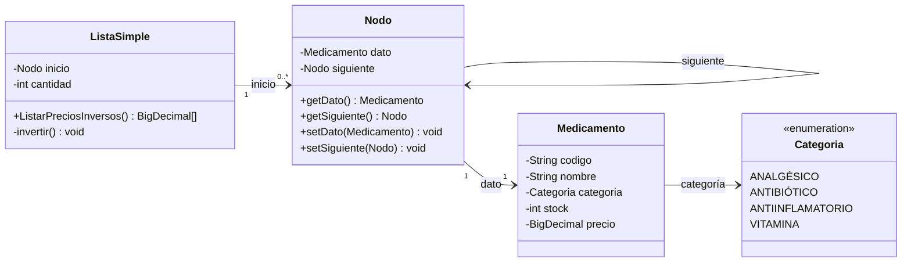

<div align="center">

# 💊 FarmaVida

### Sistema de Gestión de Inventario Farmacéutico · Parcial 1

Aplicación de consola desarrollada en **Java puro** que administra el inventario de medicamentos de una farmacia utilizando una **lista simplemente enlazada** como estructura de datos central. Cada operación del inventario está respaldada por su **documentación de lógica** (pseudocódigo, trazados y casos borde) y por una **batería de casos de prueba**.

[](https://www.java.com/es/)
[](https://code.visualstudio.com/)
[](FarmaVida/src/ListaSimple.java)
[](#estado-del-proyecto)
[](https://github.com/RelaxUniver/Parcial-1/commits/master/)

</div>

---

## Índice

- [Descripción del Proyecto](#descripción-del-proyecto)
- [Características Principales](#características-principales)
- [Tecnologías](#tecnologías)
- [Estructura del Repositorio](#estructura-del-repositorio)
- [Arquitectura y Modelo de Datos](#arquitectura-y-modelo-de-datos)
- [Operaciones sobre la Lista](#operaciones-sobre-la-lista)
- [Documentación de Lógica](#documentación-de-lógica)
- [Datos de Prueba](#datos-de-prueba)
- [Batería de Casos de Prueba](#batería-de-casos-de-prueba)
- [Cómo Ejecutar el Proyecto](#cómo-ejecutar-el-proyecto)
- [Convenciones de Diseño](#convenciones-de-diseño)
- [Estado del Proyecto](#estado-del-proyecto)
- [Equipo de Trabajo](#equipo-de-trabajo)
- [Contacto](#contacto)

---

## Descripción del Proyecto

**FarmaVida** es un proyecto académico de evaluación parcial (**Parcial 1**) desarrollado en equipo. Simula la gestión del inventario de una farmacia, donde los medicamentos se almacenan en una **lista simplemente enlazada** ([`ListaSimple`](FarmaVida/src/ListaSimple.java)) construida manualmente sobre nodos ([`Nodo`](FarmaVida/src/Nodo.java)) que se recorren desde `inicio` hasta `null`.

Sobre esta estructura se implementan **cinco operaciones de inventario (a–e)**:

| | Operación | Propósito |
|---|---|---|
| **a** | `MedicamentosAgotados()` | Detectar medicamentos con stock bajo (≤ 5 unidades). |
| **b** | `PromedioPrecioPorCategoria(String)` | Calcular el precio promedio de una categoría. |
| **c** | `ActualizarStock(String, int)` | Reabastecer un medicamento buscándolo por código. |
| **d** | `ListarPreciosInversos()` | Obtener los precios en orden inverso al de ingreso. |
| **e** | `AplicarAumentoGeneral(double)` | Incrementar todos los precios por un porcentaje. |

Cada operación cuenta con dos artefactos que la respaldan:

1. 📘 Un **documento de lógica** en la carpeta [`Documentación/`](Documentaci%C3%B3n/) con la idea general, el pseudocódigo, un trazado iteración por iteración con el estado de los punteros y el análisis de casos borde.
2. 🧪 Una **batería de casos de prueba** en [`Main.java`](FarmaVida/src/Main.java) con casos positivos, negativos y borde, mostrando el estado *antes*, la *llamada*, el resultado *esperado*, el estado *después* y el resultado *obtenido*.

---

## Características Principales

- ✅ **Estructura de datos implementada desde cero**: lista simplemente enlazada sin uso de colecciones de Java (`java.util.List`, etc.).
- 💰 **Precisión monetaria**: los precios se manejan con [`BigDecimal`](FarmaVida/src/Medicamento.java), evitando los errores de punto flotante.
- 🛡️ **Validación defensiva**: el constructor de `Medicamento` rechaza campos `null`, stock negativo y precios negativos mediante `IllegalArgumentException`.
- 🔢 **Categorías tipadas**: el `enum` [`Categoria`](FarmaVida/src/Categoria.java) restringe los valores posibles (ANALGÉSICO, ANTIBIÓTICO, ANTIINFLAMATORIO, VITAMINA).
- 🔄 **Operaciones no destructivas**: `ListarPreciosInversos()` aplica el patrón *mutar–extraer–restaurar* para devolver la lista a su estado original.
- 📘 **Documentación técnica completa**: cada operación tiene su documento de lógica con pseudocódigo y trazado de punteros.
- 🧪 **Pruebas manuales estructuradas**: `Main.java` imprime el trazado completo de cada caso con su valor esperado.
- 🚫 **Cero dependencias externas**: solo el JDK; no requiere Maven, Gradle ni librerías de terceros.

---

## Tecnologías

| Tecnología | Uso en el proyecto |
|---|---|
| **Java SE (8+)** | Lenguaje de implementación. Solo JDK estándar (`java.math.BigDecimal`, `java.util.Arrays`). |
| **Visual Studio Code** | IDE del proyecto, con el *Extension Pack for Java*. Configuración en [`FarmaVida/.vscode/settings.json`](FarmaVida/.vscode/settings.json) (fuentes en `src/`, salida en `bin/`). |
| **Git / GitHub** | Control de versiones y alojamiento del repositorio. |
| **Markdown** | Formato de la documentación de lógica y de este README. |

---

## Estructura del Repositorio

```text
Parcial-1/
├── README.md                                ← Este archivo (portal del proyecto)
│
├── Documentación/                           ← Documentación técnica de cada operación
│   ├── Lógica_ActualizarStock.md
│   ├── Lógica_AplicarAumentoGeneral.md
│   ├── Lógica_ListarPreciosInversos.md
│   ├── Lógica_MedicamentosAgotados.md
│   └── Lógica_PromedioPrecioPorCategoria.md
│
└── FarmaVida/                               ← Proyecto Java (workspace de VS Code)
    ├── .vscode/
    │   └── settings.json                    ← Rutas de fuente (src), salida (bin) y librerías
    ├── src/                                 ← Código fuente
    │   ├── Categoria.java                   ← Enum de categorías de medicamentos
    │   ├── Medicamento.java                 ← Modelo de dominio con validaciones
    │   ├── Nodo.java                        ← Nodo de la lista enlazada
    │   ├── ListaSimple.java                 ← Lista enlazada + operaciones del inventario
    │   └── Main.java                        ← Punto de entrada y batería de pruebas
    └── bin/                                 ← Clases compiladas (.class) generadas por VS Code
        ├── Categoria.class
        ├── ListaSimple.class
        ├── Medicamento.class
        └── Nodo.class
```

### Detalle de archivos

| Archivo | Descripción |
|---|---|
| [`Documentación/`](Documentaci%C3%B3n/) | Carpeta con los cinco documentos de lógica (uno por operación). Ver [Documentación de Lógica](#documentación-de-lógica). |
| [`FarmaVida/src/Categoria.java`](FarmaVida/src/Categoria.java) | `enum` con las 4 categorías del inventario: `ANALGÉSICO`, `ANTIBIÓTICO`, `ANTIINFLAMATORIO` y `VITAMINA`. |
| [`FarmaVida/src/Medicamento.java`](FarmaVida/src/Medicamento.java) | Clase de dominio con los atributos `codigo`, `nombre`, `categoria`, `stock` (int) y `precio` (BigDecimal). El constructor valida que ningún campo sea `null` y que no existan stock ni precios negativos. Incluye *getters* y *setters*. |
| [`FarmaVida/src/Nodo.java`](FarmaVida/src/Nodo.java) | Nodo genérico de la lista: envuelve un `Medicamento` (`dato`) y un enlace al siguiente nodo (`siguiente`). |
| [`FarmaVida/src/ListaSimple.java`](FarmaVida/src/ListaSimple.java) | Lista simplemente enlazada con `inicio` y `cantidad`. Contiene el método auxiliar privado [`invertir()`](FarmaVida/src/ListaSimple.java), la operación implementada `ListarPreciosInversos()` y los bloques comentados que reservan cada operación pendiente a su responsable. |
| [`FarmaVida/src/Main.java`](FarmaVida/src/Main.java) | Punto de entrada: construye la lista de 5 medicamentos y ejecuta la batería de pruebas de las operaciones (ver [Batería de Casos de Prueba](#batería-de-casos-de-prueba)). |
| [`FarmaVida/.vscode/settings.json`](FarmaVida/.vscode/settings.json) | Configuración del proyecto Java en VS Code: `sourcePaths: ["src"]`, `outputPath: "bin"`, librerías referenciadas en `lib/**/*.jar`. |
| [`FarmaVida/bin/`](FarmaVida/bin/) | Artefactos de compilación (`.class`) generados automáticamente por VS Code. |

---

## Arquitectura y Modelo de Datos

### Diagrama de clases



### La lista en memoria (datos de ejemplo de `Main.java`)

```text
inicio                                                          cantidad = 5
  │
  ▼
┌─────────────┐   ┌─────────────┐   ┌─────────────┐   ┌─────────────┐   ┌──────────────┐
│     M01     │   │     M02     │   │     M03     │   │     M04     │   │      M05     │
│ Paracetamol │──▶│ Amoxicilina │──▶│ Ibuprofeno  │──▶│ Vitamina C  │──▶│ Azitromicina │──▶ null
│  stock: 15  │   │  stock: 3   │   │  stock: 2   │   │  stock: 20  │   │   stock: 5   │
└─────────────┘   └─────────────┘   └─────────────┘   └─────────────┘   └──────────────┘
```

Cada `Nodo` almacena un `Medicamento` y un puntero `siguiente`. El recorrido de cualquier operación comienza en `inicio` y termina cuando `siguiente == null`.

---

## Operaciones sobre la Lista

Las cinco operaciones se declaran sobre [`ListaSimple`](FarmaVida/src/ListaSimple.java). Cada una tiene un responsable asignado, su documento de lógica y su batería de pruebas en [`Main.java`](FarmaVida/src/Main.java):

| # | Firma del método | Descripción | Retorna | Responsable | Documentación | Estado |
|---|---|---|---|---|---|---|
| **a** | `MedicamentosAgotados()` | Devuelve los nombres de los medicamentos cuyo stock sea **menor o igual a 5** unidades. | `String[]` | Jorge Luis Reyes Pérez | [📘 Lógica_MedicamentosAgotados.md](Documentaci%C3%B3n/L%C3%B3gica_MedicamentosAgotados.md) | 🚧 Documentada — pendiente de implementar |
| **b** | `PromedioPrecioPorCategoria(String categoria)` | Devuelve el precio promedio de los medicamentos de la categoría especificada (`0.0` si no existen). | `BigDecimal` | Geonel Sánchez | [📘 Lógica_PromedioPrecioPorCategoria.md](Documentaci%C3%B3n/L%C3%B3gica_PromedioPrecioPorCategoria.md) | 🚧 Documentada — pendiente de implementar |
| **c** | `ActualizarStock(String codigo, int cantidadAgregada)` | Busca un medicamento por su código y le suma la cantidad entregada. | `boolean` (`true` si existe) | Merlyn Sosa Borges | [📘 Lógica_ActualizarStock.md](Documentaci%C3%B3n/L%C3%B3gica_ActualizarStock.md) | 🚧 Documentada — pendiente de implementar |
| **d** | `ListarPreciosInversos()` | Devuelve la lista de precios en **orden inverso** al que fueron ingresados, restaurando la lista original. | `BigDecimal[]` | Yaisel Pinos Durán | [📘 Lógica_ListarPreciosInversos.md](Documentaci%C3%B3n/L%C3%B3gica_ListarPreciosInversos.md) | ✅ Implementada y probada |
| **e** | `AplicarAumentoGeneral(double porcentaje)` | Incrementa el precio de **todos** los medicamentos según el porcentaje dado (fracción decimal: `0.25` = 25 %). | `int` (modificados) | Ray Sanjudo Mesa | [📘 Lógica_AplicarAumentoGeneral.md](Documentaci%C3%B3n/L%C3%B3gica_AplicarAumentoGeneral.md) | 🚧 Documentada — pendiente de implementar |

> ℹ️ Los nombres de los responsables y la signatura de cada operación constan como comentarios de bloque dentro de [`ListaSimple.java`](FarmaVida/src/ListaSimple.java), marcando el lugar exacto donde debe agregarse cada implementación.

---

## Documentación de Lógica

La carpeta [`Documentación/`](Documentaci%C3%B3n/) contiene un documento Markdown por operación —se visualizan directamente en GitHub, sin herramientas adicionales—. Todos siguen la misma estructura de 7 secciones:

1. **Idea general** — elementos involucrados (punteros, parámetros, acumuladores) y estrategia del recorrido.
2. **Avisos importantes / correcciones incorporadas** — decisiones de diseño y trampas a evitar (p. ej. división por cero, dimensionado correcto del arreglo, convenciones de parámetros).
3. **Pseudocódigo** — algoritmo completo con validaciones (*guard clauses*) y ciclo de recorrido.
4. **Ejemplo de ejecución** — lista inicial de 3 nodos y llamada concreta a trazar.
5. **Trazado por iteraciones** — estado gráfico de los punteros (`inicio`, `actual`, `anterior`) paso a paso.
6. **Resultado final** — verificación contra el valor esperado y estado de la lista tras la llamada.
7. **Casos borde** — lista vacía, un solo nodo, parámetros `null`, negativos o inexistentes.

| Documento | Operación | Puntos clave que aborda |
|---|---|---|
| [📘 Lógica_MedicamentosAgotados.md](Documentaci%C3%B3n/L%C3%B3gica_MedicamentosAgotados.md) | **(a)** Medicamentos agotados | Recorrido en **dos pasadas** (contar → llenar) para dimensionar el arreglo con el tamaño exacto del resultado, no con el de la lista. |
| [📘 Lógica_PromedioPrecioPorCategoria.md](Documentaci%C3%B3n/L%C3%B3gica_PromedioPrecioPorCategoria.md) | **(b)** Promedio por categoría | Prevención de la **división entre cero** cuando la categoría no existe y uso correcto de `.equals()` (no `==`) para comparar `String` en Java. |
| [📘 Lógica_ActualizarStock.md](Documentaci%C3%B3n/L%C3%B3gica_ActualizarStock.md) | **(c)** Actualizar stock | Búsqueda por código con retorno anticipado y el **triple significado de `false`** (código `null`, cantidad negativa, medicamento inexistente), resuelto con mensajes informativos. |
| [📘 Lógica_ListarPreciosInversos.md](Documentaci%C3%B3n/L%C3%B3gica_ListarPreciosInversos.md) | **(d)** Precios en orden inverso | Patrón **mutar–extraer–restaurar** con el método auxiliar `invertir()`: la lista se invierte, se extraen los precios y se vuelve a invertir para dejarla intacta. |
| [📘 Lógica_AplicarAumentoGeneral.md](Documentaci%C3%B3n/L%C3%B3gica_AplicarAumentoGeneral.md) | **(e)** Aumento general de precios | Convención de **porcentaje como fracción decimal**, fórmula `nuevoPrecio = precio × (1 + porcentaje)` y el triple significado del retorno `0`. |

---

## Datos de Prueba

[`Main.java`](FarmaVida/src/Main.java) inicializa la lista principal con 5 medicamentos encadenados manualmente (`M01 → M02 → M03 → M04 → M05`):

| Código | Nombre | Categoría | Stock | Precio | ¿Agotado (stock ≤ 5)? |
|---|---|---|---:|---:|:---:|
| `M01` | Paracetamol | `ANALGÉSICO` | 15 | 2.50 | — |
| `M02` | Amoxicilina | `ANTIBIÓTICO` | 3 | 12.00 | ✔ |
| `M03` | Ibuprofeno | `ANTIINFLAMATORIO` | 2 | 4.50 | ✔ |
| `M04` | Vitamina C | `VITAMINA` | 20 | 5.00 | — |
| `M05` | Azitromicina | `ANTIBIÓTICO` | 5 | 15.00 | ✔ |

Adicionalmente se construyen listas auxiliares para cubrir casos específicos: una **lista vacía**, una lista **sin agotados** (`X01–X03`), una lista **todos agotados** (`Y01–Y03`) y una lista de **un solo nodo** (`Z01`, precio 7.25).

Valores de referencia que se desprenden de estos datos:

- Promedio `ANTIBIÓTICO` = `(12.00 + 15.00) / 2` = **13.50** · Promedio `ANALGÉSICO` = **2.50**
- Precios invertidos = **[15.00, 5.00, 4.50, 12.00, 2.50]**
- Aumento del 10 % → M01: 2.75 · M02: 13.20 · M03: 4.95 · M04: 5.50 · M05: 16.50

---

## Batería de Casos de Prueba

[`Main.java`](FarmaVida/src/Main.java) funciona como un *test harness* manual: por cada caso imprime el estado **ANTES**, la **LLAMADA** realizada, el resultado **ESPERADO**, el estado **DESPUÉS** y el **RESULTADO** obtenido. Cada operación cubre tres tipos de casos:

| Tipo de caso | Qué verifica |
|---|---|
| ✅ **Positivos** | Comportamiento esperado con datos válidos (p. ej. código existente, categoría con medicamentos, aumento del 10 %). |
| ❌ **Negativos** | Entradas inválidas o sin coincidencias: `null`, cantidades/porcentajes negativos, códigos o categorías inexistentes, lista vacía. |
| ⚠️ **Borde** | Situaciones límite: lista de un solo nodo, cantidad cero, porcentaje 100 %, todos/ningún elemento cumple la condición. |

> 📌 En la versión actual solo está activo el bloque de pruebas de **d) `ListarPreciosInversos()`**. Los bloques de **a**, **b**, **c** y **e** están **comentados** en `Main.java`, listos para descomentarse en cuanto cada responsable agregue su método en [`ListaSimple.java`](FarmaVida/src/ListaSimple.java).

### Salida esperada al ejecutar la versión actual

```text
=== d) ListarPreciosInversos() ===

--- Caso positivo: lista con 5 medicamentos ---
ANTES  : M01(2.50) → M02(12.00) → M03(4.50) → M04(5.00) → M05(15.00)
Llamada: ListarPreciosInversos()
Esperado: [15.00, 5.00, 4.50, 12.00, 2.50]
DESPUÉS: M01(2.50) → M02(12.00) → M03(4.50) → M04(5.00) → M05(15.00) (restaurada)
Resultado: [15.00, 5.00, 4.50, 12.00, 2.50]

--- Caso negativo: lista vacía ---
ANTES  : (lista vacía)
Llamada: ListarPreciosInversos()
Esperado: []
DESPUÉS: (lista vacía, sin cambios)
Resultado: []

--- Caso borde: lista con un solo nodo ---
ANTES  : Z01(7.25)
Llamada: ListarPreciosInversos()
Esperado: [7.25]
DESPUÉS: Z01(7.25) (restaurada)
Resultado: [7.25]
```

---

## Cómo Ejecutar el Proyecto

### Requisitos previos

- **JDK 8 o superior** instalado ([descargar aquí](https://adoptium.net/es/)). Si usas VS Code, se recomienda JDK 17+ (requisito del *Extension Pack for Java*).
- Opcional: **Visual Studio Code** con el [Extension Pack for Java](https://marketplace.visualstudio.com/items?itemName=vscjava.vscode-java-pack).

### Opción A — Visual Studio Code (recomendada)

1. Clona el repositorio:
   ```bash
   git clone https://github.com/RelaxUniver/Parcial-1.git
   ```
2. Abre **la carpeta `FarmaVida/`** en VS Code (`Archivo → Abrir carpeta…`). La configuración de [`.vscode/settings.json`](FarmaVida/.vscode/settings.json) define `src/` como carpeta de fuentes y `bin/` como salida.
3. Abre [`src/Main.java`](FarmaVida/src/Main.java) y pulsa **Run** (▶) sobre el método `main`, o usa la vista *JAVA PROJECTS*.
4. Los resultados de las pruebas se imprimen en la consola integrada.

### Opción B — Terminal (solo JDK)

```bash
git clone https://github.com/RelaxUniver/Parcial-1.git
cd Parcial-1/FarmaVida

# Compilar (UTF-8 por los identificadores con tildes, p. ej. ANALGÉSICO)
javac -encoding UTF-8 -d bin src/*.java

# Ejecutar la batería de pruebas
java -cp bin Main
```

---

## Convenciones de Diseño

| Convención | Motivo |
|---|---|
| `BigDecimal` para precios | Evita errores de redondeo del punto flotante en valores monetarios ([`Medicamento.java`](FarmaVida/src/Medicamento.java)). |
| Validación en el constructor | Un `Medicamento` nunca puede crearse con campos `null`, stock negativo ni precio negativo: falla rápido con `IllegalArgumentException`. |
| Comparación de cadenas con `.equals()` | En Java, `==` compara referencias, no contenido; usarlo con `String` produciría un *bug silencioso* (documentado en [Lógica_PromedioPrecioPorCategoria.md](Documentaci%C3%B3n/L%C3%B3gica_PromedioPrecioPorCategoria.md)). |
| *Guard clauses* + mensajes informativos | Cuando el valor de retorno es ambiguo (`false` en `ActualizarStock`, `0` en `AplicarAumentoGeneral`), se imprime un mensaje que aclara la causa antes de retornar. |
| Dos pasadas para arreglos filtrados | En `MedicamentosAgotados()` primero se cuenta cuántos cumplen la condición y luego se llena un arreglo del tamaño exacto del resultado. |
| Patrón mutar–extraer–restaurar | `ListarPreciosInversos()` invierte la lista, extrae los precios y la vuelve a invertir, sin memoria adicional y sin dejar efectos secundarios. |
| Porcentajes como fracción decimal | `AplicarAumentoGeneral(0.25)` significa +25 %; la fórmula aplicada es `precio × (1 + porcentaje)`. |
| Paquete por defecto | Las cinco clases conviven sin paquete declarado; `src/` es la raíz de fuentes y `bin/` la salida de compilación. |

---

## Estado del Proyecto

Versión actual: **primera versión** — estructura general del proyecto y documentación inicial completas.

### Progreso

- [x] Estructura base: [`Categoria`](FarmaVida/src/Categoria.java), [`Medicamento`](FarmaVida/src/Medicamento.java), [`Nodo`](FarmaVida/src/Nodo.java) y [`ListaSimple`](FarmaVida/src/ListaSimple.java)
- [x] Carga de datos de prueba y listas auxiliares en [`Main.java`](FarmaVida/src/Main.java)
- [x] Documentación de lógica de las **5 operaciones** (carpeta [`Documentación/`](Documentaci%C3%B3n/))
- [x] Baterías de casos de prueba definidas para las **5 operaciones**
- [x] **(d)** `ListarPreciosInversos()` + auxiliar `invertir()` — *implementada, pruebas activas*
- [ ] **(a)** `MedicamentosAgotados()` — *documentada, pruebas listas para activar*
- [ ] **(b)** `PromedioPrecioPorCategoria(String)` — *documentada, pruebas listas para activar*
- [ ] **(c)** `ActualizarStock(String, int)` — *documentada, pruebas listas para activar*
- [ ] **(e)** `AplicarAumentoGeneral(double)` — *documentada, pruebas listas para activar*

### Flujo de trabajo para completar una operación pendiente

1. Leer el documento de lógica correspondiente en [`Documentación/`](Documentaci%C3%B3n/).
2. Implementar el método en [`ListaSimple.java`](FarmaVida/src/ListaSimple.java), dentro del bloque comentado con el nombre del responsable.
3. Descomentar el bloque de pruebas de esa operación en [`Main.java`](FarmaVida/src/Main.java).
4. Ejecutar `Main` y verificar que cada caso coincida con su valor *Esperado*.

---

## Equipo de Trabajo

| Integrante | Operación asignada | Documentación |
|---|---|---|
| **Jorge Luis Reyes Pérez** | (a) `MedicamentosAgotados()` | [📘 Lógica_MedicamentosAgotados.md](Documentaci%C3%B3n/L%C3%B3gica_MedicamentosAgotados.md) |
| **Geonel Sánchez** | (b) `PromedioPrecioPorCategoria(String)` | [📘 Lógica_PromedioPrecioPorCategoria.md](Documentaci%C3%B3n/L%C3%B3gica_PromedioPrecioPorCategoria.md) |
| **Merlyn Sosa Borges** | (c) `ActualizarStock(String, int)` | [📘 Lógica_ActualizarStock.md](Documentaci%C3%B3n/L%C3%B3gica_ActualizarStock.md) |
| **Yaisel Pinos Durán** | (d) `ListarPreciosInversos()` | [📘 Lógica_ListarPreciosInversos.md](Documentaci%C3%B3n/L%C3%B3gica_ListarPreciosInversos.md) |
| **Ray Sanjudo Mesa** | (e) `AplicarAumentoGeneral(double)` | [📘 Lógica_AplicarAumentoGeneral.md](Documentaci%C3%B3n/L%C3%B3gica_AplicarAumentoGeneral.md) |

---

## Contacto

Proyecto mantenido por **[RelaxUniver](https://github.com/RelaxUniver)** · Repositorio: [github.com/RelaxUniver/Parcial-1](https://github.com/RelaxUniver/Parcial-1)

<div align="center">

*Proyecto de uso académico — Parcial 1 · Estructuras de Datos*

[⬆ Volver al índice](#índice)

</div>
